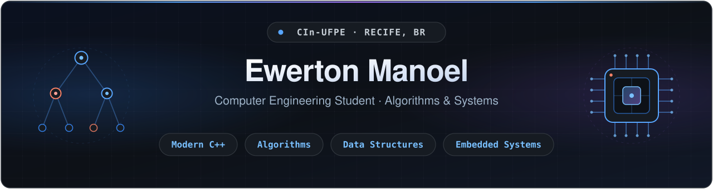

  <picture>
    <source media="(prefers-color-scheme: dark)" srcset="./banner.svg">
    <source media="(prefers-color-scheme: light)" srcset="./banner-light.svg">
    
  </picture>

  
  &nbsp;
  
  &nbsp;
  

 

### About Me

I'm a **Computer Engineering** student at **CIn-UFPE** (Recife, Brazil), focused on building strong foundations in computer science through clean implementation and algorithmic problem solving.

<table>
  <tr>
    <td width="50%" valign="top">
      <b>Algorithms &amp; Competitive Programming</b> 
      Regular practice across <a href="https://codeforces.com/profile/ewerton">Codeforces</a>, CSES, and LeetCode — maintaining a personal C++ template library covering DP, Graphs, Math, and Data Structures.
    </td>
    <td width="50%" valign="top">
      <b>Modern C++ &amp; Data Structures</b> 
      Building self-contained, template-based implementations from scratch with emphasis on correctness, memory safety, and performance.
    </td>
  </tr>
  <tr>
    <td width="50%" valign="top">
      <b>Computer &amp; Embedded Systems</b> 
      Exploring low-level programming in C/C++, Linux tooling, and how hardware and software interact efficiently.
    </td>
    <td width="50%" valign="top">
      <b>Developer Tooling &amp; Automation</b> 
      Creating lightweight utilities (such as Node.js automation scripts) to streamline practice workflows and keep solutions organized.
    </td>
  </tr>
</table>

---

### Tech Stack

  <picture>
    <source media="(prefers-color-scheme: dark)" srcset="https://skillicons.dev/icons?i=cpp%2Cc%2Cpython%2Clinux%2Cgit%2Cgithub%2Cvscode&theme=dark&perline=7" />
    <source media="(prefers-color-scheme: light)" srcset="https://skillicons.dev/icons?i=cpp%2Cc%2Cpython%2Clinux%2Cgit%2Cgithub%2Cvscode&theme=light&perline=7" />
    
  </picture>

---

### Featured Projects

| Project | Description | Focus |
| :--- | :--- | :--- |
| **[Library](https://github.com/ewertonManoel/Library)** | Personal competitive programming library with C++ templates across `DP`, `Graphs`, `Math`, and `Extra` (Fenwick Tree, Segment Tree, Dijkstra, Miller-Rabin, Matrix Exp, and more). | `C++` · `Algorithms` |
| **[Red-Black-Tree](https://github.com/ewertonManoel/Red-Black-Tree)** | Template-based Red-Black Tree in C++ with `NIL` sentinel, RAII memory management, copy safety, and guaranteed `O(log n)` operations. | `Modern C++` · `Data Structures` |
| **[Codeforces](https://github.com/ewertonManoel/Codeforces)** | Contest solutions and upsolving archive focused on algorithmic techniques and problem-solving refinement. | `C++` · `Competitive Programming` |
| **[CSES](https://github.com/ewertonManoel/CSES)** | Structured C++ solutions to the CSES Problem Set emphasizing graph algorithms, DP, and theoretical foundations. | `C++` · `CSES` |
| **[Leetcode](https://github.com/ewertonManoel/Leetcode)** | C++ solutions automatically synced to GitHub via a custom local Node.js server and browser trigger. | `C++` · `Node.js` · `Automation` |

---

### GitHub Activity

  <picture>
    <source media="(prefers-color-scheme: dark)" srcset="https://github-readme-stats.vercel.app/api?username=ewertonManoel&show_icons=true&hide_border=false&bg_color=0d1117&border_color=30363d&title_color=58a6ff&icon_color=58a6ff&text_color=c9d1d9&ring_color=58a6ff" />
    <source media="(prefers-color-scheme: light)" srcset="https://github-readme-stats.vercel.app/api?username=ewertonManoel&show_icons=true&hide_border=false&bg_color=ffffff&border_color=d0d7de&title_color=0969da&icon_color=0969da&text_color=24292f&ring_color=0969da" />
    
  </picture>
  &nbsp;
  <picture>
    <source media="(prefers-color-scheme: dark)" srcset="https://streak-stats.demolab.com?user=ewertonManoel&theme=github-dark-blue&background=0d1117&border=30363d&stroke=30363d&ring=58a6ff&fire=58a6ff&currStreakLabel=58a6ff&sideLabels=c9d1d9&dates=8b949e&currStreakNum=f0f6fc&sideNums=f0f6fc" />
    <source media="(prefers-color-scheme: light)" srcset="https://streak-stats.demolab.com?user=ewertonManoel&theme=default&background=ffffff&border=d0d7de&stroke=d0d7de&ring=0969da&fire=0969da&currStreakLabel=0969da&sideLabels=24292f&dates=57606a&currStreakNum=0f172a&sideNums=0f172a" />
    
  </picture>

  <picture>
    <source media="(prefers-color-scheme: dark)" srcset="./footer-dark.svg">
    <source media="(prefers-color-scheme: light)" srcset="./footer-light.svg">
    
  </picture>

